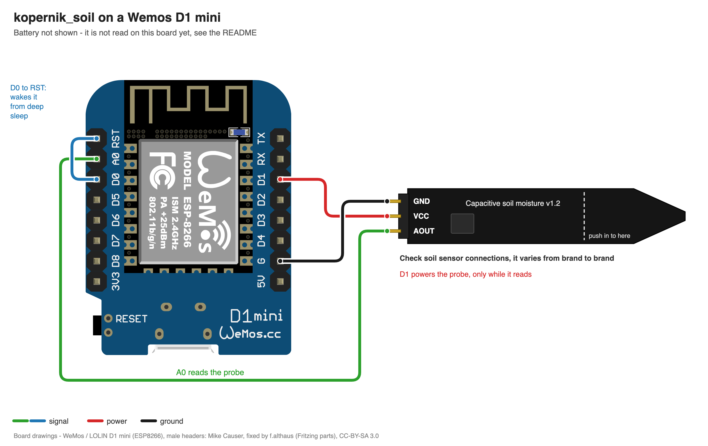
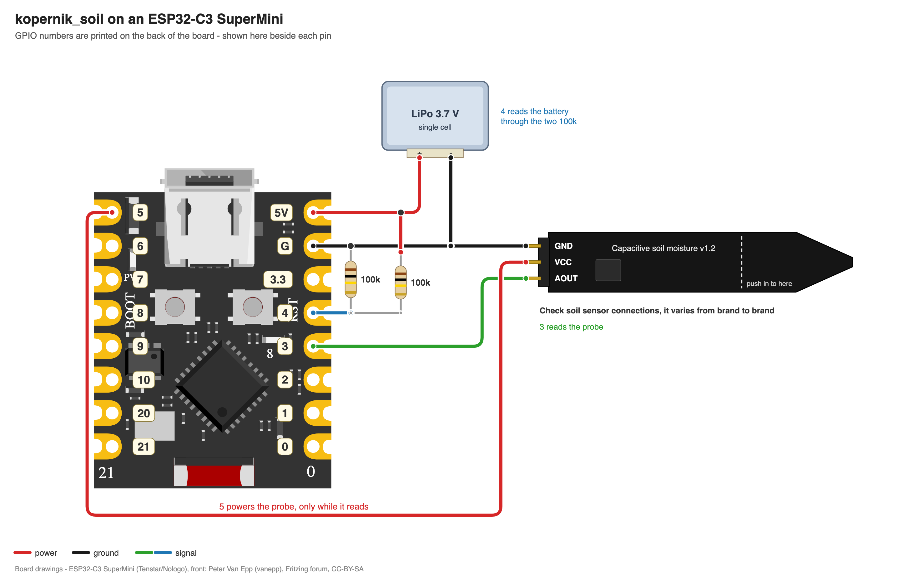

# kopernik_soil

A capacitive soil probe on a Wemos D1 mini or an ESP32-C3 SuperMini. Every cycle it posts the
moisture reading to the SoilHub at `http://192.168.4.1/ingest`, as the original sketch did. With
internet it also reports to the Frugal-IoT dashboard. Settings are in the configuration block at
the top of `kopernik_soil.ino`.

## Wiring

### Wemos D1 mini



The D0 to RST wire is what wakes the board from deep sleep. Without it the board sleeps once
and never wakes. If an upload fails, remove the wire while uploading. The battery is not read
on this board yet, because it shares A0 with the probe.

### ESP32-C3 SuperMini, or SuperMini Pro



The GPIO numbers are printed on the back of the board. The two 100k resistors halve the
battery voltage so that pin 4 can read it. No D0 to RST wire is needed.

## Building

| | PlatformIO | Arduino IDE |
|---|---|---|
| D1 mini | `pio run -e d1_mini -t upload` | Board: **LOLIN(WEMOS) D1 R2 & mini** |
| SuperMini | `pio run -e supermini -t upload` | Board: **Nologo ESP32C3 Super Mini**, and Partition Scheme: **No OTA (2MB APP/2MB SPIFFS)** |

**Arduino IDE.** Install **Frugal-IoT** 2.0.13 or later with Tools > Manage Libraries, and
choose **Install All** when it asks about dependencies. The D1 mini also needs the **esp8266**
boards package, and the SuperMini the **esp32** one. Keep every file in this folder together:
`platform.h` holds settings the library itself reads, `kopernik_soil.ino.globals.h` is how an
ESP8266 build finds them, and `partitions.csv` makes the SuperMini build fit.
Despite its name, the SuperMini's partition setting keeps over-the-air updates working, because
`partitions.csv` sets the real layout.

**Enrolment secret.** The secret lets the node join the dashboard by itself. Get it from the
dashboard's gear icon > Nodes > Enrolment secret. 

In the Arduino IDE, paste it between the quotes on the `SYSTEM_MQTT_ENROL_SECRET` line of `kopernik_soil.ino`. 

In PlatformIO, create `platformio-secrets-local.ini` beside `platformio.ini` containing:
```
    [common]
    build_flags_secrets = '-D SYSTEM_MQTT_ENROL_SECRET="paste-it-here"'
```
Without a secret the node waits on the Nodes card for an administrator to approve it. Either way,
do not share or commit a copy that has the secret in it.

## Calibrating the probe

The dry and wet values in the sketch are only starting points. On the SuperMini they are a rough
guess, since its ADC reads four times higher. Calibrate each probe once:

1. Reset the board, and within three minutes join its WiFi network, **Kopernik Soil** followed
   by six characters. The setup page opens, or browse to `http://192.168.4.1`.
2. While the captive page is in use the node stays awake.
2. With the probe dry and in air, press **Soil Moisture Tare**. That sets 0 %.
3. Put the probe in water up to the line, type `100` in **Calibrate** and submit. That sets 100 %.

The node remembers the calibration across resets and sleep. 
